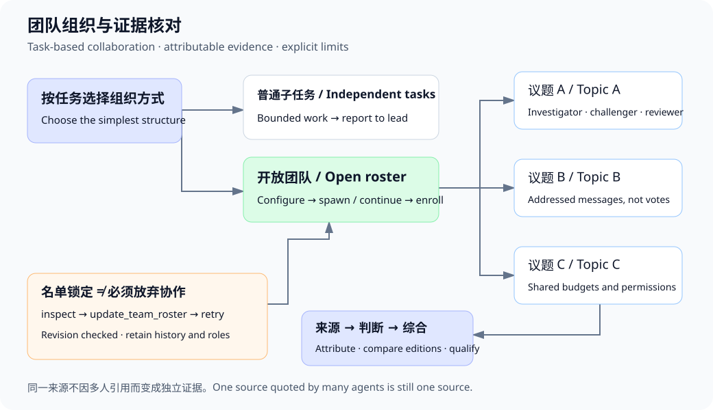

# 对话、进度与恢复

[English](INTERACTION.md) | [简体中文](INTERACTION.zh-CN.md) · [文档目录](README.zh-CN.md)

当前说明核对日期：2026-10-05；代码基线: `d663030`.

## 导航

打开对话时定位到最新内容附近。步骤支持展开／收起，折叠时显示精简实时预览；轮次导航定位用户发言。上下文／工作区状态条打开详情面板；上下文分页和知识库维护进度不必等待较慢统计完成。

思考、协作和访问控制位于输入框附近。字号有自动及 25/50/75/100/115/125/150% 档位。普通对话显示聊天文件，项目对话显示登记目录。Amadeus 改名保留已有自定义助手名。

## 实时状态

耗时包括模型、工具与审批等待，终态冻结计时。追加消息持久入队，直到安全接收点才送给模型，不能把“已排队”理解为模型已经看到。后台工作可让模型继续独立任务；前台命令仍可能占用当前运行。

客户端最多重连五次，间隔 1/2/4/8/16 秒；健康心跳重置连续失败计数。重连重新鉴权、恢复持久状态，不重发操作。事件 ID 去重，大缺口刷新快照；重试耗尽可手动连接。写请求超时不代表操作未成功。

问答与审批按事件位置插入。全局提醒菜单可跳转相关对话和卡片。桌面提醒需要浏览器授权和页面保持打开，不是常驻 Windows 通知服务；通知使用通用文本，避免暴露任务内容。

## 修改审查与恢复

文件修改按轮次分组折叠，支持红绿差异、行数、统一／前后视图。快照排除隐藏、生成、链接、二进制与过大文件，并受 400 项、2 MB、八层目录边界限制。也可能观察到用户修改，因此不是撤销或事务隔离。旧事件无法补出未记录的修改前内容。

结果不明时允许只读检查续聊，不盲目重放写入／命令。完整写入内容与已记录编辑后哈希可自动核实；剩余情况通过 resolve_effect 请求确认。“允许再次尝试”记录用户重试授权，但保留上次结果未知的事实，本身不执行命令。后续操作仍受普通审批约束。

等待审批没有到期时间，不计入命令执行时限。停止／重启取消等待并提供恢复入口，不会默许执行。明确启动前错误与执行结果未知分开处理。

## 排版与工作区预览

支持表格、公式、代码、带发言者引用和嵌入媒体。HTML、Mermaid 默认预览，可切换同尺寸滚动代码。见[排版](CHAT-FORMATTING.zh-CN.md)。

工作区 HTML 预览可内联最多 40 个范围内本地资源，有浏览器 sandbox/CSP，不能读取宿主页面。它不是任意 Python 执行、依赖安装器或完整开发服务器。见[工具边界](TOOL-ECOSYSTEM.zh-CN.md)。

## 每轮协作详情

新一轮开始后，上一轮的协作折叠栏仍保留在原来的轮次下。展开可查看成员层级、已声明的任务依赖和已记录的通信箭头，点击节点查看对应工作。历史详情按需加载；成员新出现审批或提问等待时，面板会展开提醒。

成员创建关系与任务依赖分别展示。通信次数表示消息已提交，不代表已读；旧消息缺少结构化记录时不会猜测关系。关系图最多展示 60 个节点，完整成员仍可在配套列表中查看。

## 模型请求恢复

工具参数格式错误时，每个模型步骤最多请求两次修正。临时连接失败或断流最多重连五次，等待间隔为 2/4/8/16/30 秒；界面显示进度，停止按钮可取消等待。成功响应后重置次数。仅重新请求失败的模型响应，残缺工具调用不会执行，已经完成的工具操作保留在上下文中；残缺文字标记为未完成。重试可能额外计费，缺失用量不当作实测零消耗。鉴权和配置错误不会自动重试。次数耗尽后保留可恢复的终止原因，用户设置的模型步骤上限仍生效。

## 长命令与超时测试

单个普通命令默认等待最多 10 秒，仍在运行则返回同一后台进程的任务编号。执行超时不变，审批等待不计入执行时限；界面记录转后台及后续进度。新消息可唤醒后台等待。Agent 可以继续独立工作，但不得改动该任务正在使用的文件、输出或环境；没有独立工作时事件驱动等待，不反复调用模型轮询。

短命令仍返回原退出码和输出，已调度不算测试通过证据。yieldAfterSeconds=0 保持严格同步，background=true 立即后台调度。同批多个工具调用、顺序工作流和 Hooks 默认保留同步依赖。此机制不是文件锁，也不保证模型总能选出有价值的并行工作。旧服务中已经运行的前台命令不会被追溯接管。

## 粘贴文本与草稿预览

粘贴达到 8,000 字符或 100 行时，自动通过现有上传流程生成 Markdown 文本附件，发送前保留在草稿附件区，可像普通附件一样移除，不会自动进入知识库或记忆。保存期间禁止发送；保存失败保留原文，可重试或放回草稿。

短 Markdown／公式粘贴会打开预览，点“编辑”回到未改写的源码。支持表格、代码块和 KaTeX 数学公式。这是源码／预览切换，不是所见即所得富文本编辑器。草稿不执行 HTML、不获取外部图片；附件原有容量限制仍生效。

### 更新与参数修复

快捷启动会检查源码指纹并在服务未运行时重建。已有服务运行时只打开旧实例；重新构建文件也不会热更新内存中的服务。请先结束任务并停止服务，再运行 Start-Amadeus.cmd。First-Start-Amadeus.cmd 用于准备锁定依赖及构建，不会在运行中替换依赖。

工具参数格式错误最多连续修复两次，每次成功的模型响应后重置额度；仍失败时可恢复中断，残缺调用不执行。网络重连与参数修复是不同机制。看到历史失败记录不代表当前版本仍采用相同逻辑。安全清单是待验证建议，不能作为已经发现或修复漏洞的证据。

## 实时任务进度

输入框上沿汇总已提交、进行中、待开始和受阻数量。SSE 更新及重连刷新任务板。新消息待接收不代表计划已更新；模型接收后可用 extend_plan 追加新要求，保留旧状态与证据。已提交不等于独立验收通过。

### 协作证据

团队共享状态区分唯一证据事件、重复观察、执行者和同文检索片段。多个 Agent 引用同一段内容不会证明来源独立；重复测试属于复测。输出不同需要核查，不直接判为事实矛盾。现有任务质疑仍须由较新的、绑定当前产物的证据处理，不能投票解决。来源链不明时明确标为独立性尚未建立。

## 侧栏列表

项目与普通对话共用一个滚动区域，根据侧栏可用高度分配默认展示数量（各最多 5 项），使用“显示更多／收起”；项目内对话同样分批展开。置顶对话优先且保留可见，其余按最近活跃时间排序；项目按创建时间与未归档对话活动时间中较新者排序。收起时保留当前对话及其项目。搜索包含项目名称及全部匹配对话，不受收起数量限制。除当前项目和搜索匹配项外，项目默认折叠。无需新增设置或修改启动项。

### 建队、等待与讨论额度

创作团队可先调用 `configure_team(autoEnroll=true, members=[当前 runId])`，再委派成员。后续新建及继续的成员会同步加入；普通委派和固定名单模式不变。权限、深度、资源上限与团队最多 32 个成员的限制仍有效。已结束成员用 `continue_agent` 保留上下文继续，不会自动唤醒或伪装为活跃成员。只有协调者能通过工具调整讨论额度，调整不清空记录。额度统计每成员发送的消息数，不是辩论轮次，也不是独立证据数；“没有新证据时汇总”仍是模型决策，不能当作已证明的收敛检测。

`wait_agents` 在收到待处理输入或等待满 60 秒后返回，子任务继续运行。等待团队消息、等待分配任务也会响应新输入。模型在下一个循环边界接收消息，并非同时启动第二个主模型请求。自动化策略支持建队前保存、发出刷新事件，并由同一对话的后续团队继承；保存不会直接建队或授予写权限。界面显示成员名称、兼任职责和讨论额度，支持直接修改额度；失败显示原因，成功按服务端回执更新保存状态。本次无新增安装依赖，重启主服务生效。

### 自动组织方式

新对话及未显式设置组织方式的对话默认使用 `auto`。模型可按任务选择普通子 Agent、创作讨论团队或宿主调度团队，无需让用户先选基础设施。用户明确选择的主从、宿主或创作模式以及关闭协作仍然有效。自动模式不会强制建队、扩大权限、豁免审批或移除并发／费用限制。团队选择及理由会记录并展示。建队前模型工作工具列表可发现建队和直接通讯入口，建队后加入相关团队通讯与调度工具。这是让模型具备按任务选择组织方式的能力，不代表已实现经过校准的自动规划器或最优分工保证。启动项及安装依赖不变。

### 历史加载与团队可见性

打开对话先取最近 500 条事件，较早记录按需翻页；这是分页大小，不是历史保留上限。实时更新使用事件游标。团队成员记录也增量刷新，执行步骤中可加载更早记录。每轮展示普通委派或团队模式、成员完成／运行／需关注数量，以及单独的任务完成数量；完成不等于验收通过。关系图可切换成员、任务依赖和实际通讯。后台恢复仅读取相关运行的工具事件，成员扫描使用元数据，避免反复解析历史模型上下文。现有启动器会按源码变化重建，无新增依赖或首次配置步骤。

### 议题分组与可恢复的入队配置

`configure_team` 默认开放自动入队：先建队，再创建或继续成员。显式固定名单仍会阻止创建／继续；协调者可检查版本后调用 `update_team_roster`，开放入队或加入同任务树的活跃成员，不清空消息、角色或任务。已结束参与、权限和资源限制仍然有效。

`configure_team_group` 在一个团队内划分并行议题，`team_discuss(groupId)` 定向投递给该组成员；除协调者外，非组员不能向该组发言。分组可重叠，共享团队消息预算、权限和协调者，不是隔离的嵌套团队。每轮面板展示分组目的和成员。继续或恢复成员时更新组员，旧消息的收件人保留历史原貌。

研究评估可记录每项结论的来源性质、判断类型、版本背景和限制，禁止将人物陈述／评论直接登记为观察事实。这是模型的可审计判断，不是真实性认证。原始文档也可能包含二手评论；未检索到不等于全文没有。自行正反分析必须与真实独立取证区分，多人重复同一引用也不增加独立来源数量。

管理职责按负责人合并显示，主负责人显示为“主 Agent”，不再重复整段对话标题。移交入口折叠在“调整管理分工”中，仅列出其他活跃成员。这些控件不会创建专业角色或新 Agent；实际成员与任务仍在对应轮次的协作视图中查看。

## 围绕具体成果的协作闭环

独立子任务可以直接向主 Agent 汇报。只有需要协调专业约束、比较方案或处理证据冲突时才使用团队协作；模型根据当前任务选择，历史上的角色安排不应成为固定模板。

这类工作通过 `configure_team(reviewRequired=true)` 声明需要成员复核。`submit_team_proposal` 提交具体方案版本，只指定与该决策相关的复核者；复核者先用 `inspect_team_proposal` 读取当前版本，再通过 `review_team_proposal` 接受或提出具体异议。作者用 `respond_team_review` 回应，或提交修改版。回应后仍待复核；修改版本使旧接受意见失效。不要求固定角色、最低消息数、全员互聊或多数投票。

团队面板显示方案版本、作者、复核者及待复核／待回应／待重新核对状态。声明需要复核却没有具体方案，或已有方案仍未处理完时，主 Agent 不能直接结束团队工作。成员可先结束自己的回合，主 Agent 后续继续同一成员处理反馈。通知未送达会明确返回；已通知也不代表已读取。

结构化讨论沿用成员消息预算，每个方案最多六个版本。协调者可说明影响后明确保留未解决分歧或撤回方案；交付中保留警告，不冒充复核通过。读取回执只能证明获取了对应版本，不能证明理解；成员接受不代表事实正确、独立证据或文件验证通过。文件产物仍走原有验证流程。

无需新增依赖或修改启动脚本。已有团队默认不强制方案复核；准备启用时重启服务即可，当前运行中的服务不会自动更新。

研究类方案可关联同范围研究记录：复核者需比较具体替代解释、可区分的观察及决策影响，关联版本必须保持有效。参见[长程阅读与研究预算](LOCAL-RAG.zh-CN.md#长程阅读与有边界的假说比较)。

## 快捷切换模型与子 Agent API

点击输入框旁的模型按钮。“主对话”可搜索已保存的连接名称／模型 ID，切换保留历史，思考档位恢复自动。“子 Agent”可选择默认连接或跟随主对话，并勾选允许 Agent 按任务选择的其他连接；主模型和默认子模型始终可选。子 Agent 配置需点击保存，失败会显示错误。入口提供设置跳转，用于管理 API 地址、密钥和新增连接。这些是模型 API 连接，不是 Claude Code 等外部 Agent 运行环境。本地无密钥服务仍可选择。

设置按当前对话保存，作用于后续新建和续跑成员，不切换运行中的成员。新建／续跑工具可传入许可范围内的 `profileId`；缺失、被删除或未获允许的连接会在执行前拒绝，不暗中换模型。省略参数使用当前子 Agent 默认值，续跑同样如此。工具权限、资料范围和资源限制不变。切换供应商会将相关对话／子任务上下文发送到所选端点，费用、上下文及图片能力可能不同。运行中锁定配置，保存模型选择时暂停发送按钮。无需数据迁移、新增依赖或修改启动项；需重启加载本次前后端更新。

消息输入框随输入、自动换行和恢复的草稿自动增高，上限为 320px 或可见窗口高度的 40%。更长内容在框内滚动，清空后收回；窗口变化或退出预览会重新计算高度。Enter／Shift+Enter、输入法及附件粘贴行为保持不变。

长文本粘贴附件使用截短的 Markdown 标题或开头文字作为文件名，并在本地清理非法字符。这是显示名称，不是模型摘要；同名附件仍由独立 ID 区分。

自动协作会在串行开展复杂研究前评估独立来源调查或核验任务。运行上下文与任务板检查提供委派阻碍、任务树剩余额度和依据声明依赖／资源判断的可并行任务。这是建议，不按“搜索”等关键词强制开子代理，也不意味着已证明效果提升。简单查询仍可单独完成；重复来源不算独立佐证。模型连接许可名单继续严格校验。

### 持久化后续任务与模型唤醒

后台任务提供可编辑的“稍后继续”“完成后检查”“定期检查”卡片，可选择对话、首次运行本机时间、重复间隔、通知策略、关联后台命令、累计启动次数上限和截止时间。完成后检查必须选择关联命令。服务可在没有新用户消息时发起模型轮次，但电脑与服务必须保持运行。通知在应用内显示，不代表邮件或系统推送。

常驻暴露 schedule_followup/inspect_schedules，让 Agent 先检查已有安排，再请求批准未来模型工作；pause_scheduled_followup 可停止本对话任务的未来启动。暂停和启动限制不中止已经运行的任务。“有变化才通知”抑制 unchanged 报告；complete 仅在该轮成功后停止周期。达到次数上限不代表验收通过。继承原权限，失败与未知副作用不静默重放。无需更新启动项。

先验收后生产的工作应关联生成命令，再用相关技能及图片／文档工具检查真实输出，最后才启动依赖步骤。技术文件检查不能证明视觉或语义质量；模型审查也可能出错，需保留发现和未解决项。外部队列应使用有界周期检查；提交队列脚本完成不代表外部生成完成。

原对话内也提供定时任务卡片，可直接创建、编辑、暂停并查看本对话的执行结果，无需离开对话进入后台页。新建对话执行的结果也可从来源卡片进入。自动唤醒显示为“定时任务触发”，不冒充“You”；不会提交用户尚未发送的附件，也不作为新的用户陈述参与自动记忆学习。模型仍沿正常任务通道执行，并持久保存触发来源，不模拟键盘输入。
未发送的文本和互动结果仍保留在浏览器草稿中；定时触发不会发送或清空草稿。

对话中的后续任务默认使用两行紧凑卡片，保留暂停和运行入口；点击“管理”再展开完整提示词、历史与设置。
