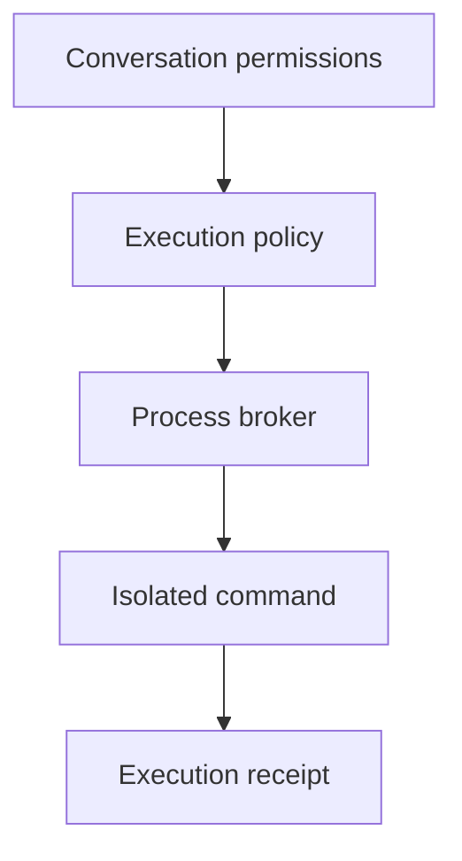

# Windows Sandbox design for Amadeus

[English](WINDOWS-SANDBOX.md) | [简体中文](WINDOWS-SANDBOX.zh-CN.md)

Status: proposed backend; prototype verified on 2026-11-18. This document and the opt-in probe do not enable a new execution backend, change permissions, or replace the existing native-windows implementation.

## Decision and evidence

Use Microsoft Execution Containers (MXC) as the candidate native Windows command backend. Keep the policy compiler, approval decision, execution broker and backend adapter separate. A command approved for a sandbox must never silently fall back to approval-host.

Codex documents MXC as its recommended compatible Windows implementation and separates approval policy from OS confinement. DSH's Windows ACL backend is useful for workspace write confinement but explicitly does not provide read or network confinement. Reuse that separation of responsibilities rather than equating restricted writes with full isolation.

Sources:

- [Codex Windows sandbox](https://learn.chatgpt.com/docs/windows/windows-sandbox.md)
- [DSH Windows ACL backend](https://github.com/deepseek-ai/deepseek-harness/blob/master/packages/sandbox/sandbox-windows-acl/README.md)
- [Microsoft MXC](https://github.com/microsoft/mxc)
- [Node V1 API](https://github.com/microsoft/mxc/blob/main/docs/api-reference/node/v1/api.md)

Windows Sandbox, the optional VM feature, is a different execution mode. Reserve it for workloads needing a separate OS environment, with explicit provisioning and resource limits. It is not the default implementation of this proposal.

## Amadeus integration contract



1. Resolve the conversation's existing execution permissions into a typed policy. Model text, retrieved documents and command descriptions cannot add permissions.
2. Canonicalize roots; reject unsupported paths, reparse points and ambiguous overlaps. Bind the request to the workspace identity and policy digest.
3. Run a capability probe and a known-good executable startup check. Distinguish unsupported OS, missing SDK, unsupported policy, runtime startup failure and workload failure.
4. Use a separate native Node broker, outside Electron's renderer and outside the HTTP event loop. It accepts a fixed, authenticated request envelope, not renderer-supplied authority.
5. Launch with explicit filesystem, network, environment and UI policies. Capture bounded output, retain the complete result artifact when appropriate, and keep tool output untrusted.
6. Return a receipt with request ID, backend, OS/SDK versions, policy digest, lifecycle state, exit code, timeout/cancellation and cleanup outcome. A started command with an uncertain outcome must not be replayed automatically.
7. Apply the same policy to descendants. Cancellation, broker crash and supervisor restart must terminate only the owned process tree; verify this before production enablement.

Planned code integration: shared execution types and settings schema; process/native-process adapters; readiness HTTP endpoint; execution UI; approval and run-environment disclosures. Existing Docker and native-windows selections remain explicit. Browser and desktop use the same main-service configuration.

## Default boundaries

| Area            | Proposed behavior                                                                                                                                                                    |
| --------------- | ------------------------------------------------------------------------------------------------------------------------------------------------------------------------------------ |
| Workspace       | Read/write only in the selected workspace and a private per-run temp directory; explicitly protected metadata excluded                                                               |
| Dependencies    | Explicit read-only runtime/dependency roots; package installation needs an approved writable cache or workspace                                                                      |
| Sensitive state | Explicit deny rules for Amadeus credentials/state, other sessions, browser profiles and repository security metadata; report overlap conflicts instead of silently broadening access |
| Environment     | Clean allowlist; private TEMP, TMP, HOME-equivalent, APPDATA and LOCALAPPDATA; no inherited API tokens, Cookies or proxy credentials                                                 |
| Network         | Deny egress, ingress and host loopback by default; local RAG, voice and control APIs are not implicitly reachable                                                                    |
| Desktop         | Isolated desktop for runtime compatibility; clipboard, input injection, desktop control and system settings denied                                                                   |
| Computer Use    | Separate authorized host capability; a shell sandbox does not grant control of the user's desktop                                                                                    |
| Host execution  | Existing independent approval route; never an automatic compatibility fallback                                                                                                       |

Absence of a read grant is not proof that every host file is unreadable: MXC documents ambient Windows ACL behavior. Explicit denies and negative tests are required. Report actual enforcement dimensions rather than a single misleading “safe” badge. See [filesystem semantics](https://github.com/microsoft/mxc/blob/main/docs/backends/process-container/filesystem.md).

Domain-scoped networking must use an enforced proxy/peer boundary with DNS, redirects and direct-IP bypass tested. Setting HTTP_PROXY alone is not enforcement. Until implemented, expose only accurately enforced network modes.

## Reproducible prototype

Install a pinned SDK in a dedicated temporary directory, not the production dependency tree:

```powershell
npm install --prefix "$env:TEMP\Amadeus-mxc-design-1.1.0" --ignore-scripts --no-audit --no-fund @microsoft/mxc-sdk@1.1.0
node scripts/probe-windows-mxc.mjs "$env:TEMP\Amadeus-mxc-design-1.1.0\node_modules\@microsoft\mxc-sdk\dist\v1\index.js"
```

The SDK ships required diagnostic telemetry; review [Microsoft telemetry documentation](https://github.com/microsoft/mxc/blob/main/docs/telemetry.md) before deployment. Do not promise that a runtime flag disables required events. Distribution, version pinning, integrity verification and telemetry disclosure are release gates.

The probe runs only fixed commands in newly created temporary directories, with synthetic canaries and a temporary loopback listener. It preserves its test directory for inspection. No project files, accounts, credentials, services or saved backend settings are changed.

Observed on Windows 11 25H2 build 26200.9974, Node 24 and MXC SDK 1.1.0:

- Platform probe: base-container supported; no DACL augmentation requested.
- Completely disabling UI: cmd succeeds; Node and Windows PowerShell fail with 0xC0000142. Block-mode diagnostics include ConvertToGui denial.
- Isolated desktop with clipboard/input/system control denied: cmd, Node and PowerShell succeed.
- Workspace write succeeds. Explicitly denied outside directory read/write and .git read fail. Test-only host environment variable is absent. A live host loopback listener is unreachable.
- These are targeted observations, not proof of complete isolation. The original host canary remains unchanged.

## Release acceptance and rollout

Required before enabling the backend:

- Positive controls: cmd, PowerShell 5/7 where supported, Node, Python, compiler, Unicode paths and paths with spaces.
- Negative controls: protected reads/writes/deletes, sibling workspace, junction/symlink/hardlink aliases, path replacement races, UNC/device paths and metadata nesting.
- Network: a reachable control listener, then sandbox denial; IPv4/IPv6, DNS, public egress, private addresses and permitted proxy bypass attempts.
- Lifecycle: spawn descendants, timeout/cancel, broker crash, service restart and cleanup; prove no unrelated process is terminated.
- UI: validate isolation from the user's windows and clipboard; startup success alone does not prove UI isolation.
- Concurrent projects: separate temp roots and policies, no ACL cleanup races or cross-session access.
- Performance: cold and warm startup, concurrent requests, output limits and nonblocking HTTP responsiveness; keep benchmark and running RAG independent.

Use opt-in preview, then capability-gated rollout. Unknown capability or policy failure blocks execution with a useful diagnostic. Never fix startup by granting an entire drive, inheriting the host environment, enabling denial capture in allow mode, or silently running outside the sandbox.
A child Node process wrote its PID before a three-second parent timeout. The host confirmed the child exited. Loading a .cjs entry point hit a drive-root lstat permission error during Node path resolution. Inline execution passed. Project script compatibility remains open.

The fixed fixture now loads a CommonJS entry point and a relative dependency from a Unicode path with spaces using Node’s explicit preserve-symlinks and preserve-symlinks-main options. These change module identity semantics for linked dependencies. Two concurrent containers each read their own marker and received an access-denied error for the other. The probe rejects a pre-existing hard link before launch. This preflight does not cover races during execution or establish OS-level alias protection.

### Release blockers measured on 2026-11-18

SDK 1.1.0 returned blocked. After the disposable broker terminated, its known-running payload exited within three seconds. A running process read replacement content when the host swapped an ordinary directory into the granted path. Ambient Windows ACLs may contribute. This fails the requirement to bind access to the original directory identity.

Both desktop and container UI configurations allowed lookup of the randomly titled synthetic host window. The test only measures discovery. No real window, input or clipboard data was accessed. The earlier description of desktop mode as a separate desktop was inaccurate. The probe reports the failed checks and exits nonzero. Production integration is gated on these checks.

The directory replacement regression now passes with a broker-owned Win32 directory handle held through completion. FILE_READ_ATTRIBUTES alone did not prevent renaming. Adding FILE_LIST_DIRECTORY and sharing read/write but not delete preserved the original directory. Renaming succeeded immediately after release. This covers the pinned grant root and its ancestors; mutable descendants need separate treatment. Explicit handles and container UI modes both left the synthetic host window discoverable. Starting the broker on a separately created desktop instead caused DLL initialization failure (0x8007045A), so that experiment did not qualify as isolation success.

The original subtree test failed with only the grant root pinned. Pinning the directories already present before dispatch made the same rename test pass. This mode holds one handle per directory and prevents renaming these directories during the run. Directories created after enumeration are outside this guarantee.

The payload successfully queried its current job and read a UI restriction mask of 0. The host window was discoverable on the default desktop. This measurement describes the queried job, not every ancestor job. On a fresh hidden desktop the same payload failed with 0x8007045A under a user-only DACL. Adding application-package access to that disposable desktop allowed initialization and the unchanged window test returned hidden. This was a synthetic diagnostic with broad package principals. The SDK's one-shot process container used different token package SIDs across repeated requests with the same containerName. Its v1 lifecycle API supports isolation_session and wslc only. Production remains gated on isolating each session with the actual authorized identity and verifying directories created during execution.

### Verification on the active package identity

The fixed verifier requires Windows, Python with pywin32, MXC SDK 1.1.0 and Node 24.21+ within the 24.x line for native pipes. Pass `--save-report` after the SDK entry point to publish the measured timestamp, versions and per-check results in the execution settings panel. The record belongs to the local service data directory. Run the verifier from the repository root with the same AGENTDEMO_DATA_DIR as the service.

A host-owned private desktop starts with a protected user-only DACL. A fixed cmd bootstrap can initialize there. The broker reads the live process token identified by the SDK, grants the resulting specific package SID access to this temporary desktop and then releases the waiting child. The synthetic host window remained discoverable in the default desktop control and was hidden from this payload. No shared application-package SID is granted. A new directory created during execution inherited directory delete restrictions in a disposable test tree. A normal rename failed and the original marker survived. This policy restricts legitimate renames too; do not apply the test ACL to a user's project. The verifier uses fixed commands; the settings report is diagnostic and does not select a command backend.
