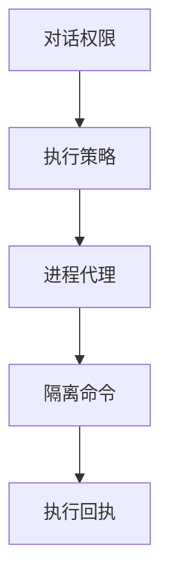

# Amadeus Windows Sandbox 设计

[English](WINDOWS-SANDBOX.md) | [简体中文](WINDOWS-SANDBOX.zh-CN.md)

状态：候选后端设计，2026-11-18 完成定向原型验证。本文和手动探针不会启用新后端、改变现有权限或替换 native-windows 实现。

## 技术选择

采用 Microsoft Execution Containers（MXC）作为新的 Windows 原生命令后端候选。权限编译、审批、进程代理和底层适配分开；沙箱启动失败不得自动转为宿主执行。

[Codex 公开文档](https://learn.chatgpt.com/docs/windows/windows-sandbox.md)推荐兼容设备使用 MXC，并将审批策略与操作系统隔离分开。[DSH 的 Windows ACL 后端](https://github.com/deepseek-ai/deepseek-harness/blob/master/packages/sandbox/sandbox-windows-acl/README.md)主要限制写入，不提供完整读取和网络隔离。借鉴其职责拆分，不能把“写入受限”标成“完全隔离”。

[Microsoft MXC](https://github.com/microsoft/mxc)与 Windows 自带的 Windows Sandbox 虚拟机功能不同。后者保留为需要独立操作系统环境时的可选方案，需单独配置资源和生命周期，不作为默认实现。

## 接入现有系统



1. 从当前对话真实权限生成类型化策略；模型输出、文件内容和命令描述不能自行扩权。
2. 规范化路径，处理权限重叠、重解析点和工作区身份；记录策略摘要。
3. 同时检测系统能力与固定程序启动，区分系统不支持、SDK 缺失、策略不支持、运行时初始化失败和命令自身失败。
4. 使用独立 Node 进程代理，避免在 Electron 渲染进程或 HTTP 主事件循环执行底层工作。请求必须经过主服务验证。
5. 显式设置文件、网络、环境和桌面策略；输出限量并保留必要的完整结果附件，工具输出仍是不可信数据。
6. 回执记录请求 ID、后端、系统/SDK 版本、策略摘要、启动状态、退出码、超时、取消和清理结果。已经启动但效果未知的命令不得自动重放。
7. 子进程继承限制；取消、代理崩溃和主服务重启只回收所属进程树，上线前实际验证。

接入位置包括 shared 执行类型与设置校验、process/native-process 适配层、就绪检测接口、执行设置页、审批和运行环境说明。现有 Docker/native-windows 保持用户显式选择；桌面版与网页版共用主服务配置。

## 默认边界

| 对象         | 设计                                                                                           |
| ------------ | ---------------------------------------------------------------------------------------------- |
| 项目         | 仅选定工作区和每次运行独立临时目录可写，受保护元数据排除                                       |
| 依赖         | 显式只读的运行时/依赖目录；安装包使用获准缓存或工作区                                          |
| 敏感信息     | 明确禁止读取凭据、Amadeus 状态、其他会话、浏览器配置及安全元数据；路径冲突报告出来，不偷偷放宽 |
| 环境变量     | 白名单重建；TEMP、TMP、用户目录、APPDATA、LOCALAPPDATA 指向私有目录，不继承密钥和 Cookies      |
| 网络         | 默认禁止出站、入站和宿主回环；本机 RAG、语音及管理接口不自动开放                               |
| 桌面         | 要求实测宿主窗口不可见，同时兼容程序初始化；禁止剪贴板、输入注入、桌面控制和系统设置访问                       |
| Computer Use | 单独授权的宿主能力，不由命令沙箱授予                                                           |
| 宿主执行     | 继续独立审批，不能作为兼容性自动回退                                                           |

[MXC 文件系统文档](https://github.com/microsoft/mxc/blob/main/docs/backends/process-container/filesystem.md)说明系统已有 ACL 会影响访问。没有显式授权不等于所有宿主文件都不可读，需要明确拒绝路径和反向测试。界面分别显示读、写、网络、桌面和进程回收能力，不用一个“安全”标记掩盖局限。

按域名联网必须通过真正强制的代理边界，验证 DNS、重定向及直接 IP 绕行；只设置 HTTP_PROXY 不算限制。实现前只提供已被准确强制的网络模式。

## 原型与复测

SDK 仅安装到独立临时目录，不加入生产依赖：

```powershell
npm install --prefix "$env:TEMP\Amadeus-mxc-design-1.1.0" --ignore-scripts --no-audit --no-fund @microsoft/mxc-sdk@1.1.0
node scripts/probe-windows-mxc.mjs "$env:TEMP\Amadeus-mxc-design-1.1.0\node_modules\@microsoft\mxc-sdk\dist\v1\index.js"
```

SDK 包含必需诊断遥测，上线前应公开说明并核对 [Microsoft 遥测文档](https://github.com/microsoft/mxc/blob/main/docs/telemetry.md)，不能声称普通运行参数能够关闭这些事件。分发方式、版本锁定、完整性验证及遥测说明均属于发布条件。

探针只在新建临时目录执行固定命令，使用合成测试文件和临时回环监听器；保留目录供核查，不读取真实凭据，不更改项目、账号、服务或保存的后端配置。

本机 Windows 11 25H2 26200.9974、Node 24、SDK 1.1.0 的定向结果：

- 支持 base-container，不要求额外 DACL 调整。
- 完全禁用 UI 时，cmd 成功，Node/Windows PowerShell 出现 0xC0000142；阻断诊断包含 ConvertToGui 拒绝。
- 使用允许 GUI 初始化的策略、继续禁止剪贴板/注入/系统控制后，三个程序均成功。
- 工作区写入成功；明确拒绝的外部目录读写、.git 读取被阻止；宿主测试环境变量没有继承；无法连接正在监听的宿主回环端口。
- 原始测试文件未变。这些是定向验证，不代表全部安全边界已验证。

## 上线验收

必须补齐：PowerShell 5/7、Python/编译器、中文空格路径；跨工作区读取与删除；硬链接、目录联接、符号链接、路径替换竞态、UNC/设备路径；IPv4/IPv6、DNS、公网/内网及代理绕行；子进程超时取消、代理崩溃、服务重启和清理；真实宿主窗口/剪贴板隔离；多项目并发策略与清理；冷暖启动延迟和 HTTP 响应。

先提供可选预览，通过能力和行为验证后再逐步启用。能力未知或策略失败就停止并说明原因。不能用整盘读取、继承宿主环境、允许式拒绝记录或宿主裸执行修复启动兼容性。LightRAG、benchmark 等独立服务不纳入沙箱进程回收。
本机补测中，Node 子进程先写入自己的 PID，父进程触发 3 秒超时后，宿主确认子进程已经退出。直接加载 .cjs 文件时，Node 解析路径遇到盘符根目录 lstat 权限错误；内联命令通过。普通项目脚本兼容性仍需验证。

补测使用 Node 的 --preserve-symlinks 和 --preserve-symlinks-main 参数，从带中文和空格的目录加载 CommonJS 入口及相对依赖。对使用链接依赖的项目，这些参数会改变模块身份解析。两个并发容器分别读到自己的文件，访问对方文件时均收到权限错误。探针在启动前识别并拒绝已有硬链接。此项只验证启动前检查，运行期间的路径竞争和操作系统级别的别名隔离仍待验证。

### 2026-11-18 上线阻塞项

SDK 1.1.0 的一次完整本机测试返回 blocked。代理被终止后，已确认启动的测试进程在 3 秒内退出。宿主将一个新的普通目录移到已授权目录原路径后，运行中的进程读到了替换内容。此观察不能单独区分路径策略和已有 Windows ACL 的影响，但不满足绑定原目录身份的要求。

宿主通过随机标题找到自己创建的隐藏测试窗口。分别请求 desktop 和 container UI 隔离的测试程序也能找到它。只检测了窗口可见性；未操作任何真实窗口、输入或剪贴板。此前将 desktop 描述为独立桌面不准确。探针现在会报告未通过项并返回非零退出码，生产接入仍被阻止。
